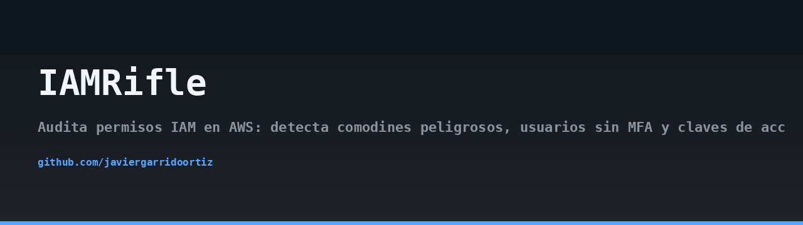
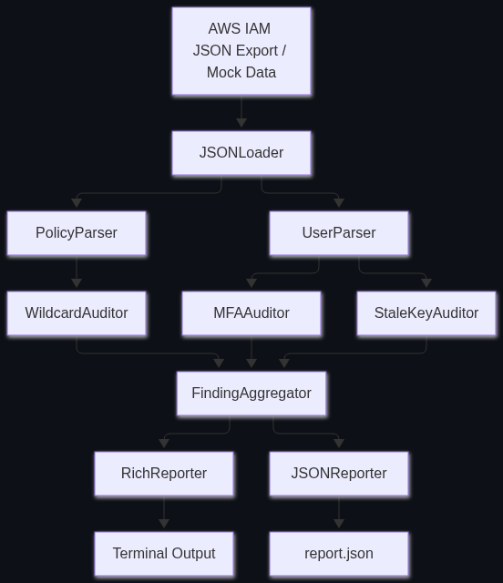
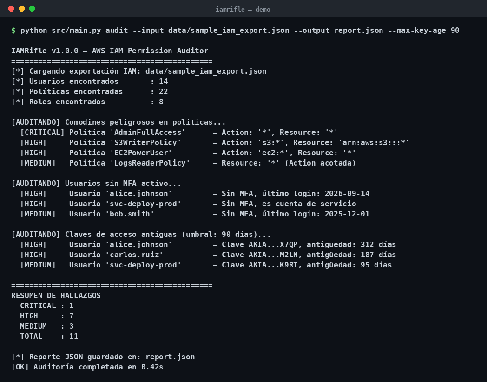

## Architecture



## Demo



> 🇪🇸 Read this in [Spanish](README.md).

# IAMRifle

**IAMRifle** audits IAM permissions in AWS from a simple exported JSON. It detects dangerous wildcards, users without MFA, and old access keys. Designed for security engineers who need quick, offline analysis of IAM configurations.

## Features

- **Wildcard detection**: Scans all policies for `*` and `?` in `Action` or `Resource`, classifies severity.
- **MFA enforcement**: Identifies IAM users without active MFA devices.
- **Stale key detection**: Flags access keys older than a configurable threshold (default 90 days).
- **Offline & online modes**: Works with exported JSON or directly against AWS (via `boto3`/`moto`).
- **Rich terminal output**: Colorful tables and panels for quick review.
- **JSON report**: Machine-readable output for integration with other tools.

## Architecture

IAMRifle follows a layered architecture:

1. **Input layer**: `JSONLoader` reads and validates the IAM export JSON using Pydantic v2 models.
2. **Mock generator**: `MockIAMBuilder` produces realistic synthetic exports for testing without AWS.
3. **Analysis layer**: Three independent auditors:
   - `WildcardAuditor`: Finds wildcards in policies.
   - `MFAAuditor`: Checks MFA status per user.
   - `StaleKeyAuditor`: Compares key age against threshold.
4. **Aggregation**: `FindingAggregator` consolidates, deduplicates, and sorts findings by severity.
5. **Reporting**: `RichReporter` (terminal) and `JSONReporter` (file) output results.
6. **CLI**: Built with `typer`, exposes `audit`, `mock-generate`, and `version` commands.

## Installation

```bash
# Clone the repository
git clone https://github.com/yourusername/iamrifle.git
cd iamrifle

# Install dependencies (Python 3.11+ required)
pip install -r requirements.txt
```

## Usage

### Audit an exported JSON

```bash
python -m src.main audit --input data/sample_iam_export.json --output report.json --stale-days 90
```

Flags:
- `--input` / `-i`: Path to IAM export JSON (required).
- `--output` / `-o`: Path to output JSON report (default: `report.json`).
- `--stale-days` / `-s`: Age threshold in days for access keys (default: 90).
- `--no-rich`: Disable rich terminal output (only JSON report).

### Generate mock data

```bash
python -m src.main mock-generate --output data/mock_export.json --users 10 --roles 5
```

Flags:
- `--output` / `-o`: Path to output JSON (default: `data/mock_export.json`).
- `--users` / `-u`: Number of mock users (default: 5).
- `--roles` / `-r`: Number of mock roles (default: 3).

### Show version

```bash
python -m src.main version
```

## Input JSON Schema

The input JSON must follow the AWS IAM export structure. Example snippet:

```json
{
  "Users": [
    {
      "UserName": "alice",
      "CreateDate": "2023-01-15T10:00:00Z",
      "MFADevices": [
        {"SerialNumber": "arn:aws:iam::123456789012:mfa/alice", "EnableDate": "2023-01-20T08:30:00Z"}
      ],
      "AccessKeys": [
        {"AccessKeyId": "AKIA...", "CreateDate": "2023-02-01T12:00:00Z", "Status": "Active"}
      ],
      "InlinePolicies": [
        {
          "PolicyName": "admin-policy",
          "PolicyDocument": {
            "Version": "2012-10-17",
            "Statement": [
              {"Effect": "Allow", "Action": "*", "Resource": "*"}
            ]
          }
        }
      ],
      "AttachedPolicies": [
        {"PolicyName": "ReadOnlyAccess", "PolicyArn": "arn:aws:iam::aws:policy/ReadOnlyAccess"}
      ]
    }
  ],
  "Roles": [
    {
      "RoleName": "ec2-role",
      "AssumeRolePolicyDocument": { ... },
      "AttachedPolicies": [ ... ]
    }
  ]
}
```

## Output JSON Schema

The report contains metadata and an array of findings:

```json
{
  "metadata": {
    "timestamp": "2025-03-22T14:30:00Z",
    "version": "1.0.0",
    "stale_days_threshold": 90
  },
  "findings": [
    {
      "id": "wildcard-001",
      "severity": "CRITICAL",
      "category": "WILDCARD",
      "resource": "arn:aws:iam::123456789012:user/alice",
      "description": "Policy 'admin-policy' allows Action:* on Resource:*",
      "details": { ... }
    }
  ]
}
```

## Severity Levels

| Severity | Description |
|----------|-------------|
| CRITICAL | Wildcard action and resource (`*:*`), or full admin privileges. |
| HIGH     | Wildcard action on specific resources, or user without MFA with active keys. |
| MEDIUM   | Wildcard resource on specific actions, or access key older than threshold. |
| LOW      | Minor wildcard usage (e.g., `s3:Get*`), or informational findings. |
| INFO     | Best practice suggestions. |

## MITRE ATT&CK Mapping

| Finding               | Technique | Description |
|-----------------------|-----------|-------------|
| Wildcard permissions  | T1098     | Account Manipulation: attackers may exploit overly permissive policies. |
| Stale access keys     | T1552.005 | Unsecured Credentials: long-lived keys increase risk of compromise. |
| Users without MFA     | T1078.004 | Valid Accounts: lack of MFA facilitates unauthorized access. |

## Contributing

Contributions are welcome! Please open an issue or submit a pull request. Ensure tests pass with `pytest`.

## License

This project is licensed under the MIT License. See the [LICENSE](LICENSE) file for details.

---

*Author: Javier Garrido Ortiz*