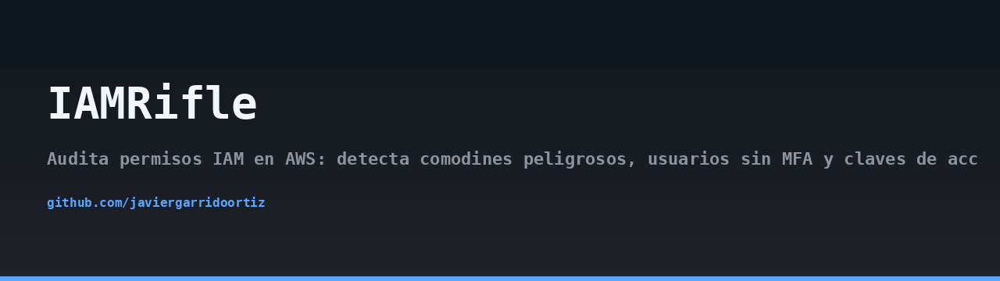
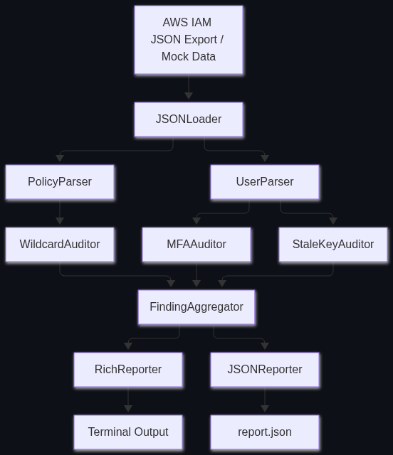
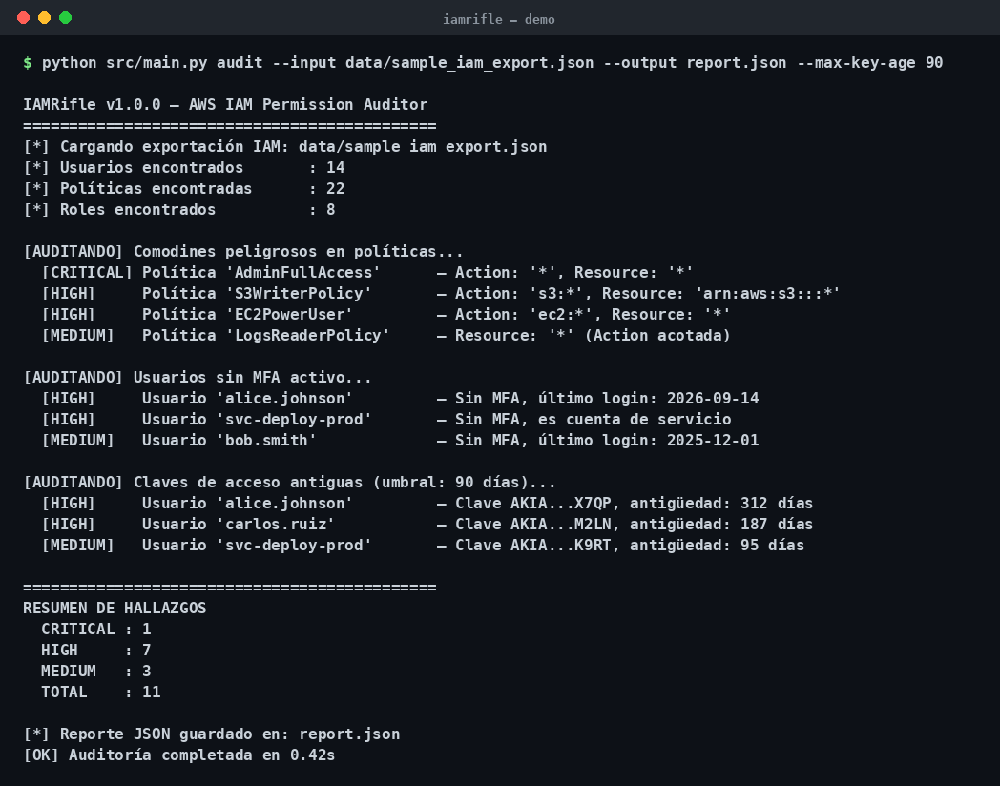
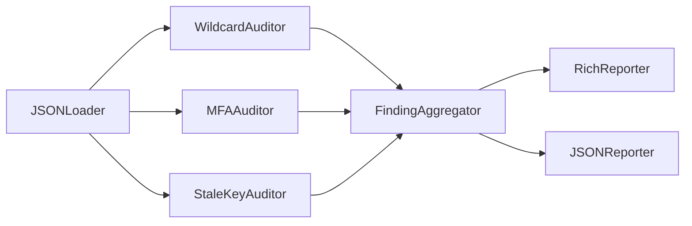

## Arquitectura



## Demo



> 🇬🇧 Read this in [English](README.en.md).


# IAMRifle

Auditor de permisos IAM para AWS. Analiza una exportación JSON de tu cuenta y detecta comodines peligrosos, usuarios sin MFA y claves de acceso antiguas, sin necesidad de conectarse a AWS.

## 1. Descripción y motivación

Revisar IAM a mano es lento, propenso a errores y casi nunca se hace con la frecuencia debida. En una cuenta mediana hay decenas de usuarios, roles y políticas administradas, y los problemas suelen pasar desapercibidos hasta que ocurre un incidente: una política con `Action: "*"` sobre `Resource: "*"`, una cuenta de administrador sin segundo factor o una access key que lleva dos años sin rotarse.

IAMRifle automatiza esa revisión sobre un volcado JSON del estado de IAM (obtenido con `aws iam get-account-authorization-details` o generado en modo mock). Los tres vectores que cubre son los más frecuentes según el **CIS AWS Foundations Benchmark** y aparecen una y otra vez en informes de respuesta a incidentes:

- **Permisos excesivos por comodines**: políticas que conceden `*` en `Action` o `Resource` rompen el principio de mínimo privilegio y amplían el radio de impacto de cualquier credencial comprometida.
- **Usuarios sin MFA**: el CIS Benchmark (control 1.5) exige MFA para la cuenta root y recomienda encarecidamente su uso en usuarios con acceso a consola. Un usuario sin MFA es una contraseña filtrada lejos de ser una brecha.
- **Claves de acceso antiguas**: el control 1.14 del CIS recomienda rotar las access keys cada 90 días. Las claves viejas suelen estar en scripts olvidados, repositorios públicos o portátiles sin cifrar.

IAMRifle no sustituye a AWS Config ni a Security Hub, pero sí te da una foto inmediata, reproducible y versionable de tu postura IAM sin dependencias de red.

## 2. Arquitectura



El flujo es lineal y cada capa tiene una única responsabilidad:

- **JSONLoader** (`src/loader.py`): lee el fichero de entrada, lo valida con modelos Pydantic v2 y expone una estructura tipada con usuarios, roles, políticas y credenciales. Si el JSON no cumple el esquema, falla con un mensaje claro antes de que ningún auditor procese datos incorrectos.
- **Auditores** (`src/auditors.py`): tres módulos independientes que reciben el modelo validado y emiten objetos `Finding`.
  - `WildcardAuditor` recorre cada `Statement` de cada política y clasifica la gravedad según la combinación de comodines en `Action` y `Resource`.
  - `MFAAuditor` cruza usuarios con sus dispositivos MFA activos y enriquece el hallazgo con la fecha del último login.
  - `StaleKeyAuditor` compara la fecha de creación de cada access key con el umbral configurable (90 días por defecto).
- **FindingAggregator**: consolida los hallazgos de los tres auditores, elimina duplicados y los ordena por severidad descendente.
- **Reporters** (`src/reporters.py`): `RichReporter` pinta tablas y paneles en terminal; `JSONReporter` escribe un `report.json` con metadatos de auditoría (timestamp, versión, umbral usado).

El punto de entrada (`src/main.py`) es un CLI construido con **typer** que expone los subcomandos `audit`, `mock-generate` y `version`.

## 3. Instalación

Requiere Python 3.11 o superior.

```bash
python -m venv .venv
source .venv/bin/activate
pip install -r requirements.txt
```

Dependencias principales: `boto3`, `rich`, `typer`, `pydantic>=2`, `moto` y `pytest` (estas dos últimas solo para desarrollo).

## 4. Uso rápido

### Auditar una exportación existente

```bash
python -m src.main audit --input data/sample_iam_export.json --format rich
```

Para generar además un informe JSON:

```bash
python -m src.main audit \
  --input data/sample_iam_export.json \
  --output report.json \
  --max-key-age 60 \
  --format json
```

Flags disponibles:

- `--input` (obligatorio): ruta al fichero JSON de exportación IAM.
- `--output` (opcional): ruta del informe JSON de salida. Por defecto `report.json`.
- `--max-key-age` (opcional): umbral en días para considerar una access key antigua. Por defecto `90`.
- `--format` (opcional): `rich` para salida en terminal, `json` para escribir solo el fichero. Por defecto `rich`.

### Generar datos mock

Útil para probar el proyecto sin una cuenta AWS real:

```bash
python -m src.main mock-generate --output data/sample_iam_export.json
```

### Ver versión

```bash
python -m src.main version
```

## 5. Formato de entrada

IAMRifle espera un JSON con la estructura típica de `get-account-authorization-details`, simplificada. Fragmento de ejemplo:

```json
{
  "account_id": "123456789012",
  "generated_at": "2024-11-01T10:00:00Z",
  "users": [
    {
      "user_name": "deploy-bot",
      "mfa_devices": [],
      "last_login": "2024-09-15T08:30:00Z",
      "access_keys": [
        {
          "access_key_id": "AKIAEXAMPLE0001",
          "status": "Active",
          "create_date": "2023-01-10T12:00:00Z"
        }
      ]
    }
  ],
  "policies": [
    {
      "policy_name": "TooMuchPower",
      "document": {
        "Version": "2012-10-17",
        "Statement": [
          {
            "Effect": "Allow",
            "Action": "*",
            "Resource": "*"
          }
        ]
      }
    }
  ]
}
```

Los campos `mfa_devices`, `last_login` y `access_keys` son opcionales; si faltan, los auditores correspondientes los tratan como ausentes (lo que suele elevar la severidad).

## 6. Formato de salida

El informe `report.json` incluye metadatos y la lista de hallazgos ordenada por severidad:

```json
{
  "tool": "IAMRifle",
  "version": "1.0.0",
  "generated_at": "2024-11-01T10:05:00Z",
  "max_key_age_days": 90,
  "findings": [
    {
      "id": "WILDCARD-001",
      "type": "wildcard_permission",
      "severity": "CRITICAL",
      "resource": "policy/TooMuchPower",
      "description": "Policy allows Action:* on Resource:*",
      "evidence": {"action": "*", "resource": "*"}
    }
  ]
}
```

## 7. Hallazgos y severidades

| Tipo | Severidad por defecto | Referencia |
|------|-----------------------|------------|
| `wildcard_action_resource` | CRITICAL | CIS 1.16 / MITRE T1098 |
| `wildcard_action` | HIGH | CIS 1.16 |
| `wildcard_resource` | MEDIUM | CIS 1.16 |
| `user_without_mfa` | HIGH | CIS 1.5 |
| `stale_access_key` | MEDIUM | CIS 1.14 |
| `root_account_usage` | CRITICAL | CIS 1.1 / 1.7 |

La matriz de severidad es configurable en el código de `WildcardAuditor` para adaptarse a políticas internas más estrictas.

## 8. MITRE ATT&CK

| Técnica | ID | Cómo la cubre IAMRifle |
|---------|----|------------------------|
| Account Manipulation | T1098 | Detecta políticas que permiten modificar usuarios, roles o políticas sin restricción de recurso |
| Unsecured Credentials: Cloud Instance Metadata API | T1552.005 | Señala credenciales de larga duración que podrían extraerse desde instancias comprometidas |
| Valid Accounts: Cloud Accounts | T1078.004 | Identifica usuarios sin MFA y claves antiguas que facilitan el uso de cuentas válidas |

## 9. Contribuir y licencia

Las contribuciones son bienvenidas. Antes de abrir un pull request:

1. Ejecuta la suite de tests: `pytest -q`.
2. Añade tests para cualquier nuevo auditor o tipo de hallazgo.
3. Mantén los mensajes y comentarios en español, salvo en `README.en.md`.

El proyecto se distribuye bajo licencia **MIT**. Consulta el fichero [LICENSE](LICENSE) para el texto completo.

Autor: Javier Garrido Ortiz.